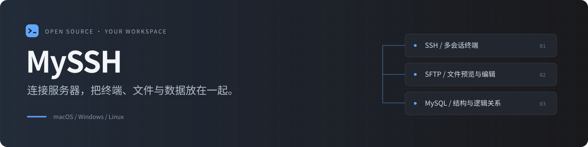
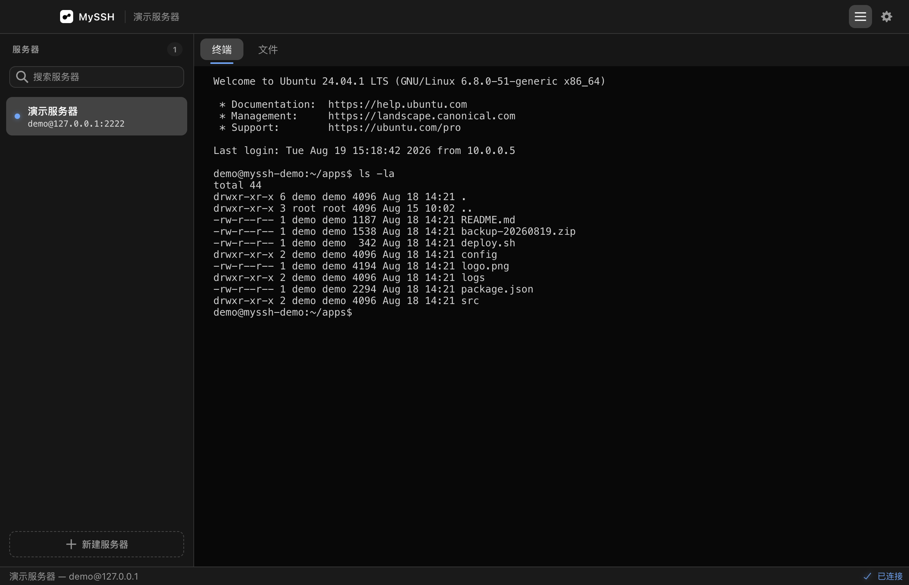
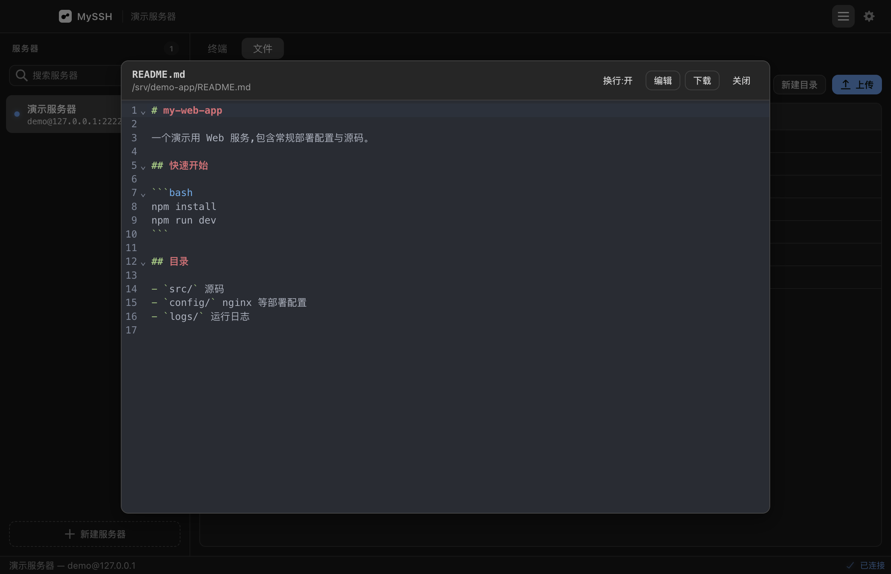
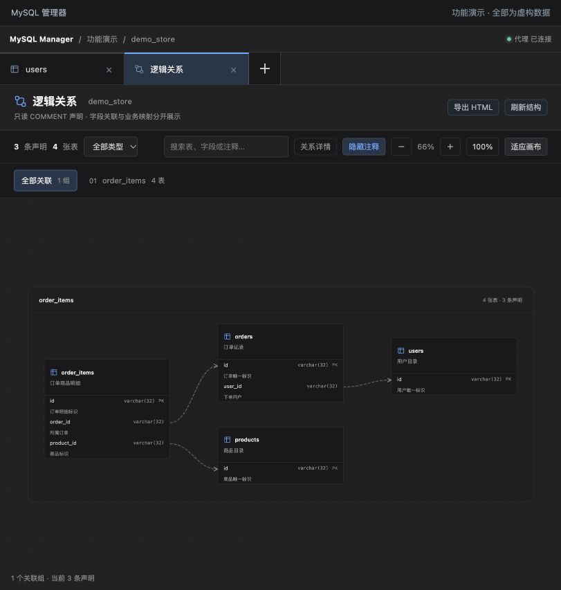
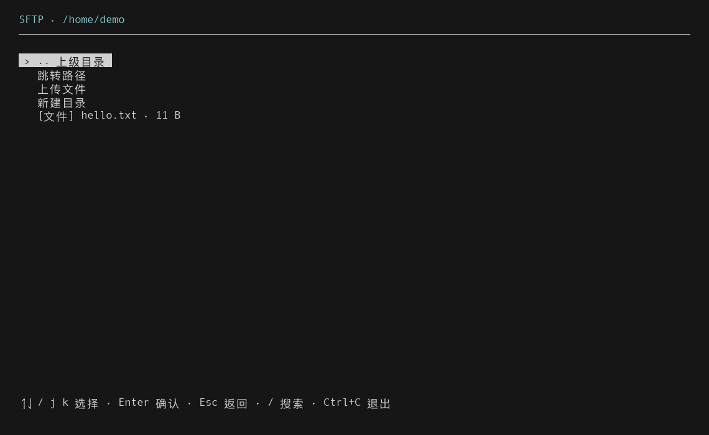

<p align="center">
  
</p>

<p align="center">
  <a href="https://github.com/Chengyunlai/my-ssh/releases/latest"></a>
  <a href="https://github.com/Chengyunlai/my-ssh/actions/workflows/ci.yml"></a>
  <a href="LICENSE"></a>
</p>

<p align="center">
  <a href="https://github.com/Chengyunlai/my-ssh/releases/latest"><strong>下载安装</strong></a> ·
  <a href="#工作区里有什么">功能实景</a> ·
  <a href="docs/TUI.md">终端版指南</a> ·
  <a href="https://github.com/Chengyunlai/my-ssh-plug">插件市场</a> ·
  <a href="CONTRIBUTING.md">参与开发</a>
</p>

MySSH 是面向开发者的开源服务器工作区。连接 SSH 后，可以在同一个应用里运行命令、处理远程文件、查看服务与监控，再通过插件进入数据库工作台。桌面与终端界面共用 SSH / SFTP 核心。



## 工作区里有什么

| 连接与终端 | 文件与预览 | 数据与服务 |
| --- | --- | --- |
| 密码 / PEM 私钥认证，多服务器、多会话与独立 Shell | SFTP 上传下载、目录管理、文本在线编辑 | CPU、内存、磁盘、网络监控与服务发现 |
| 桌面标签页与终端菜单，两种操作入口 | 图片、PDF、Office 内容预览 | MySQL 工作区、COMMENT 关系图、Kubernetes 通道 |

### 远程文件，直接打开处理

浏览目录、预览内容、修改文本、传输文件。传输显示字节数与速度；支持的图片和文档可以在工作区内查看。



### 数据库里的信息，读得更清楚

MySQL 管理器提供库表导航、SQL 查询与分页结果。JSON 用树形详情查看，ENUM 用标签和下拉选项呈现，中文 COMMENT 与字段结构一起显示。

<p align="center">
  
</p>

在 COMMENT 中声明逻辑关联，即可查看自动布局的关系画布。选择连线查看字段配对和说明，生成 JOIN 草稿，或导出可交互的单文件 HTML，分享结构与关系快照。

<details>
<summary><strong>查看 COMMENT 关系画布</strong></summary>
<br />

<p align="center">
  
</p>

关系来自显式注释声明，不创建物理外键；表级业务映射不生成 JOIN。导出不包含业务数据行、连接配置或凭据。

</details>

[了解 MySQL 管理器](https://github.com/Chengyunlai/my-ssh-plug/tree/main/src/mysql-manager) · [COMMENT 声明语法](https://github.com/Chengyunlai/my-ssh-plug/blob/main/docs/mysql-logical-relations.md)

### 留在终端里，也能继续工作

TUI 提供连接管理、多 Shell、SFTP、文件预览、系统监控和终端插件。可以使用独立 npm 安装包，也可以下载自带运行时的单文件程序。



[终端版安装与操作](docs/TUI.md)

### 从集群服务进入数据库

Kubernetes 面板可导入 kubeconfig、发现授权命名空间中的 Service / Pod，并建立本机回环通道。展开 Pod 可查看指标与容器日志；MySQL 插件可直接选择发现的服务作为连接来源。

需要本机 `kubectl` 和对应 RBAC 权限；指标依赖 Metrics Server。当前 PostgreSQL / Redis 支持发现和通道，数据浏览使用对应客户端。

[使用示例与能力边界](examples/stage-06-kubernetes/README.md)

## 快速开始

### 桌面版

从 [GitHub Releases](https://github.com/Chengyunlai/my-ssh/releases/latest) 下载对应平台的安装包。

| macOS | Windows | Linux |
| --- | --- | --- |
| Apple Silicon · `.dmg` | `.exe` | `.AppImage` |

安装后新建服务器连接，填写地址与认证信息即可使用。Windows / Linux 可在设置中检查更新；macOS 当前使用 Releases 手动更新。

<details>
<summary>macOS 首次打开与签名说明</summary>

当前安装包尚未完成 Apple Developer ID 签名和公证。首次打开可能被系统拦截；确认下载来源后，可参考以下本地处理方式：

```bash
codesign --force --deep --sign - /Applications/MySSH.app
xattr -dr com.apple.quarantine /Applications/MySSH.app
open /Applications/MySSH.app
```

</details>

### 终端版

从同一 Release 下载平台对应的 `myssh-tui` 单文件程序；或下载 `.tgz` 后通过 Node.js 安装：

```bash
npm install -g ./myssh-tui-1.6.0.tgz
myssh
```

[各平台启动方式与环境要求](docs/TUI.md#免安装单文件程序)

### 安装插件

在「设置 → 插件市场」加载官方地址，选择需要的插件安装并启用：

```text
https://chengyunlai.github.io/my-ssh-plug/registry.json
```

插件独立更新。MySQL 管理器、命令手册、服务器监控和 WSL 终端的兼容要求见 [插件市场](https://github.com/Chengyunlai/my-ssh-plug)。

本页展示主分支与当前插件的能力；已下载安装包的具体功能以对应 Release 说明为准。所有截图使用本地演示服务或虚构数据，不含真实业务记录和内部连接信息。

## 为开发者保留清晰的入口

```bash
make install
make dev
```

提交前执行 `make check`，运行 lint、类型检查、测试与构建。

| 想做什么 | 从这里开始 |
| --- | --- |
| 理解核心、桌面与终端的边界 | [架构说明](docs/ARCHITECTURE.md) |
| 运行公共 API 示例 | [示例索引](examples/README.md) |
| 编写或接入插件 | [插件开发规范](docs/PLUGIN.md) |
| 提交改动 | [贡献指南](CONTRIBUTING.md) · [Agent 协作规范](AGENTS.md) |
| 了解版本与计划 | [更新记录](CHANGELOG.md) · [路线图](ROADMAP.md) |
| 发布与更新 | [发布说明](docs/RELEASE.md) |
| 报告安全问题 | [安全策略](SECURITY.md) |

基于 Electron、React、TypeScript、xterm.js 与 ssh2 构建。桌面凭据使用系统 `safeStorage`，TUI 使用主密码加密 vault；两端存储独立。

<p align="center"><sub>MIT License · 欢迎提交 Issue、反馈与改进。</sub></p>
