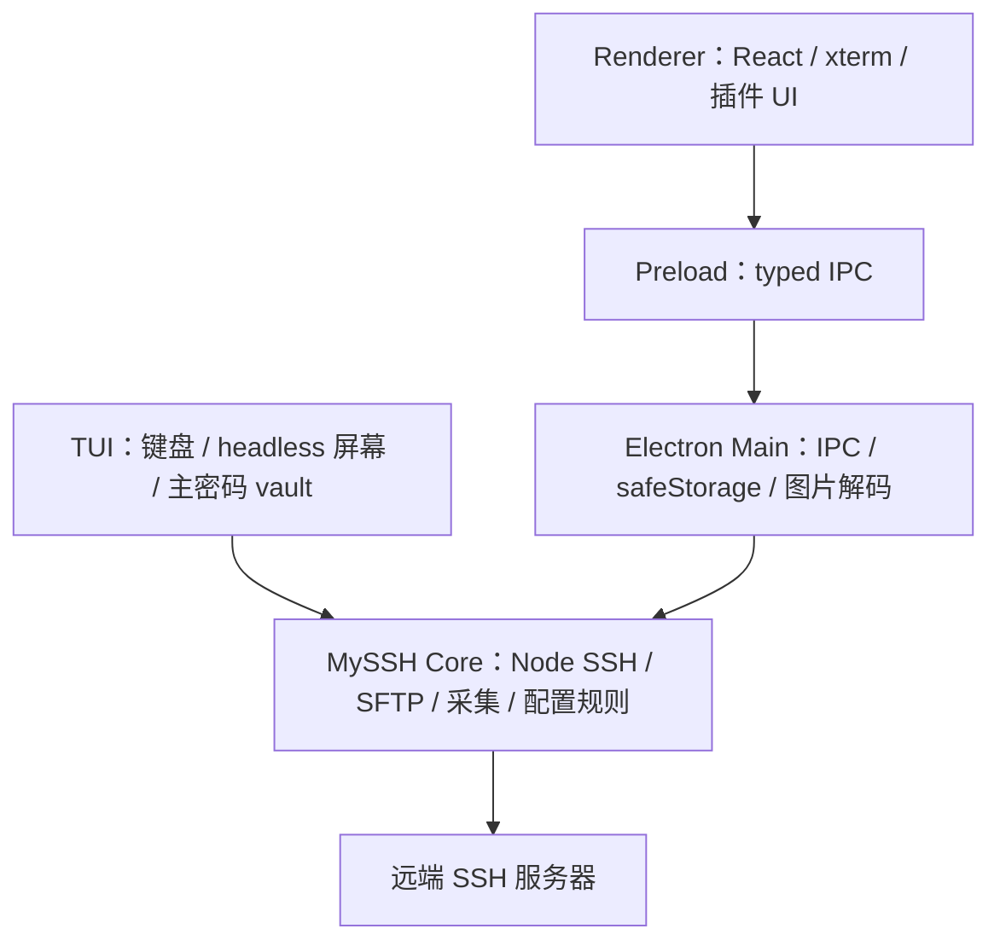

# MySSH 架构说明

本文描述稳定的进程边界、依赖方向和新增功能的落点。具体开发规则见 `CONTRIBUTING.md`，Agent
并行协作规则见 `AGENTS.md`。

## 运行时结构

图名：两个宿主复用 MySSH 核心｜图型：分层架构｜阶段：stage-01。
Core 不依赖 Electron、React 或 DOM。高权限业务能力在 Node Core 执行，可信宿主控制其生命周期。
`src/core/index.ts::createCore()` 是独立宿主的公开入口；Electron 的 `src/main/core-host.ts`
把类型化事件转发到 WebContents，并把窗口销毁映射成宿主释放。

TUI 使用独立主密码 vault，不读取 Electron 系统加密文件；桌面窗口、系统对话框、插件市场和
自动更新仍属于 Electron 宿主。TUI 的 Shell 屏幕状态与输入协议不进入业务核心。

官方插件如需本地后台服务，还可使用由 Main process 管理的 Companion Runtime：runtime bundle
由插件市场携带，核心负责校验、受控子进程生命周期、`127.0.0.1:0` 动态端口和临时 token，
renderer 只通过 capability 获取最终 endpoint。具体业务代理不进入核心，也不通过插件之间的依赖
来提供；第一阶段仅允许 registry 盖章的官方纯 JS runtime。

允许的依赖方向是 `renderer → preload API contract → main → core` 和 `tui → core`。`src/shared/` 保存两侧共享的类型和纯逻辑，
不得反向依赖任一进程实现。

## 目录职责

- `src/main/index.ts`：窗口生命周期和 IPC 组合根，不承载具体业务算法。
- `src/core/ssh.ts`、`sftp.ts`：连接与传输领域能力；`src/main/ssh.ts`、`sftp.ts` 是 Electron 适配。
- `src/core/monitor.ts`、`service-scan.ts`：固定 Linux 指标 / 服务采集、解析结果和 session 采样状态。
- `src/core/profiles.ts`：配置校验与增删改，持久化由宿主注入。
- `src/main/storage.ts`、`profiles.ts`：桌面状态与系统加密凭据。
- `src/tui/vault.ts`：scrypt / AES-256-GCM 独立凭据，原子替换文件。
- `src/tui/shells.ts`：每 Shell 的 headless xterm buffer，后台输出不会污染菜单。
- `src/main/market.ts`、`updater.ts`：外部插件和应用更新边界。
- `src/preload/index.ts`：唯一 renderer 高权限入口，实现 `SshApi`。
- `src/renderer/src/components/`：应用级界面。
- `src/renderer/src/plugins/`：插件契约、注册表和内置插件。
- `src/shared/types.ts`：IPC 契约；`versions.ts`：无副作用的版本判断。

## 关键数据流

### SSH 会话

连接表单构造 `Profile`，通过 preload 发往主进程；主进程适配调用 Core 创建 ssh2 会话并将状态、输出和进度事件
推送回 renderer。Renderer 只管理展示状态和 xterm 实例，不持有 SSH 客户端。

会话插件的系统指标通过 `window.ssh.monitor.getSnapshot(sessionId)` 请求。主进程使用独立、无
PTY 的固定 exec 脚本读取 Linux `/proc` 与 `df`，限制单次超时、输出大小和采样频率后返回
`SystemMetricsSnapshot`；不接受插件命令、环境变量或凭据。会话关闭时 exec 通道和 CPU 差分状态
一并清理。

### SFTP 与文件预览

目录、上传、下载和保存发生在 Core。传输先写临时文件，成功后替换目标；失败只清理临时文件。
临时文件权限为 0600；远端覆盖保留旧文件 mode/owner/group，无法保留则失败。
OpenSSH rename 扩展可原子覆盖远端；不支持扩展时退回普通 rename，覆盖被拒绝则保留原文件。远程文件预览内容通过受限 IPC 返回；Office 解析运行在 Web
Worker 中，避免阻塞 UI。大小限制、内容净化和错误处理属于该边界的强制要求。

### 插件加载

内置插件随应用构建；外部插件由 registry 分发并通过 `myssh-plugin://` 加载。插件只能依赖宿主提供的
React 与 `window.ssh.*` API，不能获取 Node 或 Electron 主进程对象。完整契约见 `docs/PLUGIN.md`。

## 新增功能的落点

1. 先把与环境无关的规则建模为 `src/shared/` 或模块内纯函数，并补充单元测试。
2. 可复用 SSH / SFTP / 采集能力放在 `src/core/`；系统 API 和凭据加密适配由 `src/main/` 或 `src/tui/` 宿主拥有。
3. 在 `SshApi` 中声明最小跨进程契约，再实现 main handler 与 preload bridge。
4. Renderer 只组合交互和显示；大型状态逻辑优先抽到 hook 或领域组件。
5. 新插件能力同时更新插件文档、兼容声明和接入测试。
6. 涉及 SSH 远端数据采集时，必须复用受控宿主 API，禁止插件或 Companion Runtime 自行连接服务器。

## 架构健康信号

- `App.tsx`、设置页和全局样式已较大；新增功能优先提取稳定领域模块，避免继续集中堆叠。
- IPC channel、请求参数和返回值应保持类型化，避免裸字符串与 `unknown` 在多层扩散。
- 不以“减少文件数量”为目标；以边界清晰、修改局部化和可独立测试为准。
- 跨三个以上模块的行为变化应在 `docs/adr/` 增加轻量决策记录，说明背景、决定和后果。

## 核心验收入口

示例根目录是 [`examples/`](../examples/README.md)，先运行 `npm run example:core`。
该示例使用回环虚拟 SSH 服务，输出 `CORE_OK 你好` 与 `Hello SFTP`。
`npm run verify:tui` 在 macOS/Linux 使用真实 PTY 验证菜单与业务链；Windows 需要人工在
Windows Terminal 验证键盘交互。CI 的三平台矩阵验证类型、测试、构建和独立包。
设计记录见 [`plans/core-tui.md`](plans/core-tui.md)，验证结果见
[`implementation/stage-01.md`](implementation/stage-01.md)。

抽取决策及后果见 [ADR 0006](adr/0006-shared-core-and-tui.md)。
