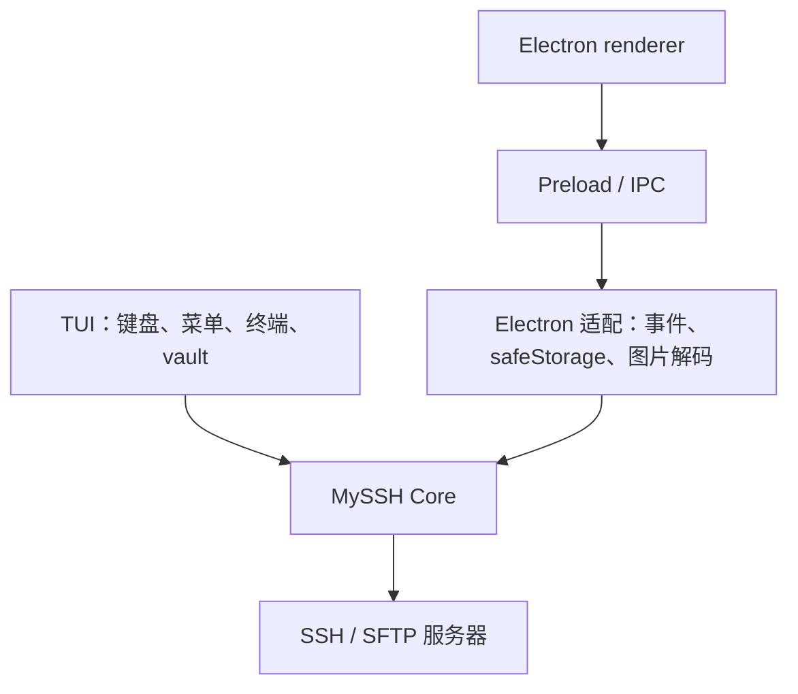

# 抽取 MySSH Core 并提供终端交互版本

## 背景与目标

桌面安装和未签名应用增加了尝试成本。将 SSH、SFTP、监控、服务发现和连接管理抽为
不依赖 Electron、React、DOM 的 Node 核心，Electron 和 TUI 共同调用。

## 范围与验收

- 保留桌面 IPC / preload / renderer 合同、已有 profiles 文件格式和系统加密能力。
- TUI 提供连接增删改、密码 / 私钥认证、连接测试、多会话、多 Shell、远程文件浏览、
  上传下载、目录创建、删除、文本预览编辑、系统监控和服务发现。
- 凭据不得明文保存；TUI 使用主密码加密的独立 vault，不自动读取桌面加密文件。
- 非文本文件可下载后由本地应用打开；React 外部插件不直接运行于终端。
- 核心错误清理、宿主释放、截断文件禁用编辑、凭据文件损坏 / 错误口令须可验证。
- TUI 独立包仅依赖 ssh2 和 Node，不分发 Electron；本次不发布 npm / GitHub Release。

采用内置能力为当前范围；外部 React 插件适配另行定义。TUI 和桌面有不同的文件展示方式。

## 架构

图名：桌面与终端共享 MySSH 能力｜图型：分层架构｜阶段：stage-01。
Mermaid 为 D0 交付；未连接 draw.io 画布。

## 实现与验证预案

先抽核心和桌面适配，再接入 TUI、独立打包和文档。负责目录为 src/core、src/tui、
受影响的 src/main 适配和测试、构建配置与文档。没有并行执行者。

Example：`examples/stage-01-core-tui/user_code/main.mjs`，通过公开 `src/core/index.ts`
连接本地测试 SSH 服务、执行命令并关闭会话；`core/README.md` 解释真实源码。
关键断点：createCore、connect、setupShell、read、ProfileStore.save。
运行：`npm run example:core`；预期得到本地测试服务的固定回显。
验证：`make check`，核心回归 / 本地 SSH+SFTP 集成，TUI PTY 键盘操作，独立包安装与帮助输出。

基线：master / bbef9c0d5dc7ac9aa05acbaf404e8ff26889f83d，开始时工作区干净。
实现和验证记录写入 `docs/implementation/stage-01.md`；本次未授权提交或远端操作。

状态：代码与文档已落地，验证结果见 [实现记录](../implementation/stage-01.md)。通过分支 `codex/feat/core-tui` 交付。
