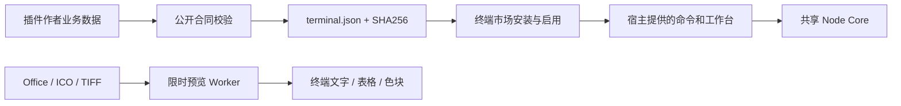

# 终端兼容性与剩余差异

关联 [Issue #35](https://github.com/Chengyunlai/my-ssh/issues/35)。

基线主线 `46da5ffca47c237ead0877659c48e27e872097b3` / 1.5.0，开始时工作区干净。
用户授权继续实施；分支 `codex/feat/tui-compatibility`，单一执行者负责 TUI、公开插件合同、Core 有限读取与 OSC/CWD 流处理、验证与文档。

目标：把已知差异拆成可交付行为和可核对证据，保持共享 Core 和现有桌面能力。

- 第三方：公开 `myssh-tui/plugin` 与 `--validate-plugin`，共用业务数据的可运行市场示例，独立包与实际市场安装链。
  已向用户请求具体第三方源码；未指定时不假装适配不存在的插件。任意 React 页面不能自动转成 ANSI 界面。
- 预览：DOCX 保留标题/列表/表格，PPTX 按真实幻灯片关系分页，ICO 支持普通 DIB，多帧 TIFF；原有 Worker/大小/控制字符边界。
  可信 Node Core rawBinary 选项读取 PPTX，最多 5 MiB，不扩展桌面 IPC。
- 平台：UTF-8 分块输入、实际 Vim/tmux 全屏与菜单恢复验收；WSL 列表取消、进程出错/取消后的终端恢复，提供真实 Windows 检查入口。
  当前执行宿主为 macOS；真实 Windows WSL 和人工字体/IME 体验需要相应机器，不能用 mock 充当实测。

验收：make check、公开包类型导入、错误描述拒绝、PTY/ConPTY 预览/市场链、真实全屏应用、明确的 Windows 验收报告。
非目标：无限格式支持、像素级 Office 排版/动画、未提供源码的第三方业务、读取已有业务服务器或自动安装 WSL。

图名：第三方接入与受限预览｜图型：数据流｜阶段：stage-05。Mermaid D0；未连接 draw.io。

依赖：直接声明既有 JSZip（MIT）和修补后的 xmldom 0.9.12（MIT），从 TUI 依赖移除 mammoth。
两者仅在 TUI Worker，纯 JS、不运行宏/脚本，不进入桌面包；XML 单条 2 MiB、深度 128、拒绝 DTD/实体声明。
增加的体积以精简依赖安装与单文件实测为准，lockfile 同步。
