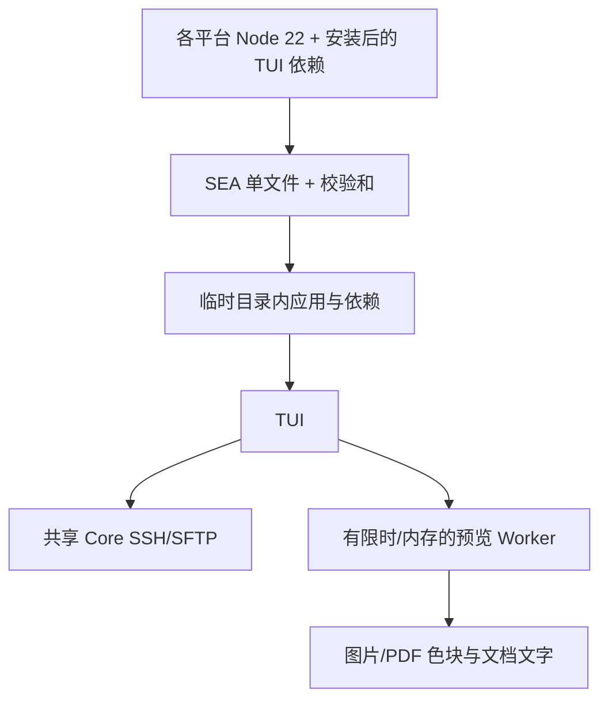

# 终端能力补齐与免 Node 分发

关联 [Issue #32](https://github.com/Chengyunlai/my-ssh/issues/32)。基线 master
`b414855dd7078639ad61fa40f5c4e6394c128689`，开始时工作区干净。

用户已授权继续实现。单个执行者负责 `src/tui/`、`scripts/`、CI/发布、依赖、文档和
`examples/stage-03-tui-portable/`；Core 与桌面 IPC 保持原接口。

stage-03 验收：单文件程序携带 Node 和所有运行依赖，无 node/npm 的环境仍可使用 SSH/SFTP；
三平台 PTY/ConPTY 验证；终端内图片色块、PDF 分页图像/文字、DOCX 文本和 XLS/XLSX 表格；
不打开浏览器，不执行文档脚本、宏或外链。5 MiB 输入、12 MP 图片、限时 Worker、分页输出。
恶意格式、截断文件、终端控制字符必须有失败路径测试。

Node 22 SEA 内嵌 Brotli 压缩的应用文件与原生解码依赖，启动解压到权限受限的随机临时目录，
退出清理。Windows 原生模块可能仍被 OS 锁定，清理采用尽力而为，不缓存凭据。
每个 OS/CPU 原生构建，Mac ad-hoc 签名。免安装不等于通用跨架构或正式签名。
PDF.js/Skia 用于 PDF 图像；现有 mammoth/SheetJS 用于 Office；原生依赖增加包体。

图型：发行与预览边界；Mermaid D0，未连接 draw.io。

示例主线：`myssh --preview <本地文件>` 是公开入口，复用远程预览器；
`examples/stage-03-tui-portable/user_code/main.mjs` 生成虚拟 PNG/PDF/XLSX/DOCX 输入并调用入口。
`core/README.md` 导航真实实现，断点为 renderPreview、runPreview、SEA 文件展开。
验证：make check、独立 npm 包、npm run verify:tui-portable、真实三平台 CI。
记录：docs/implementation/stage-03.md。

stage-04 仍是本需求的一部分：终端插件合同、官方插件适配和市场入口。
React DOM 插件需要另一个终端入口，不能将未适配项算作完成。本阶段不提前关闭 Issue。

## stage-04 实施边界

主仓库分支 `codex/feat/tui-plugins` 与市场仓库 `codex/feat/tui-contributions`，两者开始时干净。
单一执行者负责主仓库 `src/shared/tui-plugin.ts`、`src/tui/plugins*`、vault 泛型、
`src/core/mysql.ts`、构建/验证及文档；市场仓库负责终端描述构建、清单版本、测试和文档。

采用声明式终端贡献：JSON 声明命令目录/监控/MySQL/WSL，SHA-256 与 renderer 入口分开校验。
已有 React 页面继续供 Electron 使用；TUI 只组合宿主提供的交互，未适配插件明确显示无终端入口。
命令目录复用官方 data.ts，由构建脚本导出 JSON，不复制 100 条命令。
MySQL 的可信 Node Core 会话直接连接用户录入的数据库，TUI 不需要额外代理端口或外部 Node。
凭据仍用主密码派生密钥加密，数据库配置独立文件，不读取桌面 localStorage。

验收：官方描述的安装/升级/禁用/卸载、命令搜索与发送确认、监控、MySQL 连接 CRUD/库表/结构/SQL/历史，
WSL 真实列表与终端交接；本地 MySQL 协议夹具与 PTY/ConPTY 验证，不用真实服务器数据。
原 SSH/SFTP 链保持有效。示例放 `examples/stage-04-tui-plugins/`，通过公开 CLI 和 `myssh-tui/mysql` 调用。
WSL 真机执行取决于 Windows 已安装发行版；CI 至少验证系统调用/参数合同与未安装失败路径。
